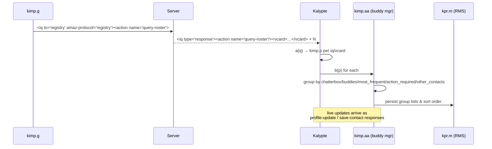
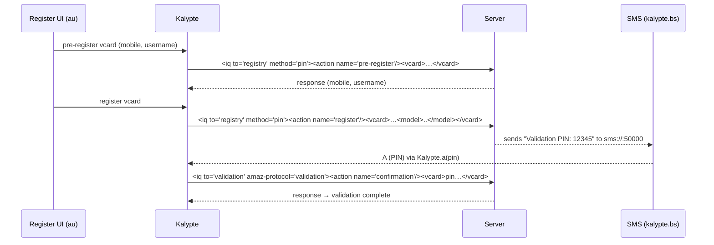

# Uzzap J2ME Wire Protocol Specification

**Source analyzed:** `/data/data/com.termux/files/home/javauzzap/com/kolipri/`
**App:** `com.kolipri.kalypte.Kalypte` — MIDlet, version `1.0.14`
**Protocol family:** Custom XML stream ("jabber:client" dialect) over a **raw TCP socket**.
Not standard XMPP — no TLS, no SCRAM, no WebSocket, no standard `<stream:features>` SASL negotiation.

> **Correction to earlier docs.** `docs/REVERSE_ENGINEERING.md` and `docs/API_AND_DATA_FLOW.md`
> describe standard XMPP (SCRAM-SHA-1, `wss://`, OMEMO). The actual decompiled code shows:
>
> - transport = `javax.microedition.io.SocketConnection` via `Connector.open("socket://host:port")` (`kpr/j.java`)
> - authentication = SASL **PLAIN only**, base64 of `\0user\0pass` (`kimp/g.java:295-302`, `kpr/k.java`)
> - no cipher/Digest/MD5/SHA/SSL/TLS anywhere in the source
> - the server password is stored **plaintext** in RMS (`Kalypte.java:212`)
>
> This document is based on the code, not the earlier prose docs.

---

## 1. Transport & Connection

### 1.1 Raw socket layer (`kpr/j.java`)

```java
// kpr/j.java:24-47
String url = "socket://" + host + ":" + port;
r = (SocketConnection) Connector.open(url, 3, true); // 3 = READ_WRITE
s = r.openInputStream();
t = r.openOutputStream();
```

- Writes are UTF-8 bytes, flushed immediately (`kpr/j.java:79-104`).
- Reads are **non-blocking polling**: `j()` only reads when `InputStream.available() > 0`,
  otherwise returns `null`. The engine polls once per second (`kimp/v.java:102-105`).
- No framing/header/length prefix. The stream is a continuous XML character stream
  parsed incrementally by a hand-written SAX-like parser (`kpr/g.java`).

### 1.2 Connection thread (`kimp/v.java`)

`kimp.v` is a `Thread` that owns:

- `a` host (default `"localhost"` → overridden)
- `b` port string (set from config but **discarded** — see below)
- `c` username, `d` password
- `g` = `kimp.g` protocol engine
- `h` = `kimp.j` event listener
- `i` = `kpr.h` outbound XML FIFO queue
- `j` = `kpr.c` pending/retry linked list

`run()` instantiates `kimp.g`, connects, then loops `g.h(); sleep(1000)`.

**Port-list bug:** `Kalypte` sets `amazilia.ports`, and `v.c(...)` stores it in `v.b`,
but `g.a(host, portstr, user, pass)` (`kimp/g.java:141-146`) only keeps host/user/pass.
The port argument is discarded and `g.o()` uses a **hard-coded** list (`kimp/g.java:167`).

### 1.3 Host / port selection (`kimp/g.java:164-218`, `o()`)

- Hosts come from RMS key `kolipri.xmpp.host_list` (comma-separated); default
  `connect.kolipri.com` (`Kalypte.java:208`).
- The chosen host index is persisted under `kolipri.xmmp.host.index` (note the typo `xmmp`)
  and rotated on each retry cycle.
- Ports are iterated from the hard-coded array:

```
5222, 8734, 10873, 40932, 80, 25, 20, 21, 110, 443, 465
```

First successful `socket://host:port` wins.

---

## 2. Server Endpoints / Constants

| Constant              | Value                                                                           | Source                                                                         |
| --------------------- | ------------------------------------------------------------------------------- | ------------------------------------------------------------------------------ |
| Default IM host       | `connect.kolipri.com`                                                           | `Kalypte.java:97,208`                                                          |
| RMS host list key     | `kolipri.xmpp.host_list`                                                        | `Kalypte.java:207`                                                             |
| RMS host-index key    | `kolipri.xmmp.host.index`                                                       | `kimp/g.java:181-184`                                                          |
| Default ports         | `5222,8734,10873,40932,80,25,20,21,110,443,465`                                 | `Kalypte.java:98`, `kimp/g.java:167`                                           |
| Stream target `to`    | `amazilia`                                                                      | `kimp/g.java:267,271`                                                          |
| XML namespace         | `jabber:client`                                                                 | `kimp/g.java:267`                                                              |
| Client version flag   | `kalyptej-1.0.14`                                                               | `kimp/g.java:271`                                                              |
| XMPP resource         | `kalyptej`                                                                      | `kimp/g.java:275`                                                              |
| SASL namespace        | `urn:ietf:params:xml:ns:xmpp-sasl`                                              | `Kalypte.java:741`                                                             |
| Bind namespace        | `urn:ietf:params:xml:ns:xmpp-bind`                                              | `kimp/g.java:275`                                                              |
| Registry targets      | `registry`, `___registry___`, `validation`, `accounts`, `subscription`, `admin` | `kimp/ae/java`, `kimp/k.java`, `kimp/i.java`, `kimp/n.java`, `kimp/g.java:280` |
| Chat conference hosts | `conference`, `conference@node1.kolipri.com`                                    | `kimp/u.java:15,28,41,54,67,86,104,117,143`                                    |
| SMS receive port      | `sms://:50000`                                                                  | `kalypte/bs.java:14`                                                           |
| Validation SMS prefix | `"Validation PIN: "` + 5 digits                                                 | `kalypte/bs.java:89-91`                                                        |
| Keep-alive byte       | `" "` (single space)                                                            | `kimp/g.java:259`                                                              |

### 2.1 Engine timing defaults (`kimp/g.java:30-48`)

| RMS key                      | Field | Default | Meaning                                        |
| ---------------------------- | ----- | ------- | ---------------------------------------------- |
| `kolipri.xmpp.retryinterval` | `j`   | 300 s   | Delay before re-sending an unacked message     |
| `kolipri.xmpp.retrylimit`    | `k`   | 3       | Max resend attempts                            |
| `kolipri.xmpp.keepalive`     | `l`   | 900 s   | Send `" "` if idle this long                   |
| `kolipri.xmpp.sleepinterval` | `m`   | 300 s   | Send `update-idle-state idle` after inactivity |
| `kolipri.roomcache.interval` | `q`   | 60 s    | Chat-room cache refresh                        |

---

## 3. XML Stream Framing & Parser Key Model

### 3.1 Parser (`kpr/g.java`, callbacks into `kimp/ab.java`)

The parser is SAX-ish. For each event it calls the `kimp.ab` (subclass of `kpr.j`) methods:

| Parser call      | `ab` method                      | Meaning                                          |
| ---------------- | -------------------------------- | ------------------------------------------------ |
| open tag + attrs | `ab.a(String name, kpr.b attrs)` | push path, emit keys                             |
| close tag        | `ab.c(String name)`              | pop path; when stack empty, dispatch to `g.a(q)` |
| character data   | `ab.d(String text)`              | append to current path's value                   |

- Namespace prefixes are **stripped**: `stream:stream` → `stream`, `foo:bar` → `bar`
  (`kpr/g.java:200-205`).
- Tag text is accumulated against a path key and dispatched only when the element closes.
- The root tag `stream` is ignored as an element; its close disconnects (`ab.java:36-67`).

### 3.2 Flattened key model (`kimp/q.java` + `kpr/b.java`)

`kimp.q` is a `kpr.b` (ordered key/value list) with a tag name. Keys are **full paths
joined by `/`**, and **attributes are appended with `.`**:

```
<iq type='response' id='x' amaz-protocol='registry'>
  <action name='query-roster'/>
  <vcard><username>bob</username><amaz-cid>A1</amaz-cid></vcard>
</iq>
```

produces keys:

```
iq                        = ""            (element self-value)
iq.type                   = "response"
iq.id                     = "x"
iq.amaz-protocol          = "registry"
iq/action                 = ""
iq/action.name            = "query-roster"
iq/vcard                  = ""
iq/vcard/username         = "bob"
iq/vcard/amaz-cid         = "A1"
```

Element text is fetched via the element key (`var0.a("message/body")`, `var0.a("iq/error")`).
Attributes via `var0.a("iq.type")`, `var0.a("message.amaz-msg-id")`.

### 3.3 CDATA

Text payloads are wrapped in `<![CDATA[ ... ]]>`. The serializers pre-escape embedded
`]]>` → `]]]]><![CDATA[>` (`kimp/s.java:341`, `kimp/u.java:151-159`).
XML special chars escaped by `kpr.i.b()` (`& < > ' "`), reversed by `kpr.i.a()`.

---

## 4. Handshake / Authentication Sequence (`kimp/g.java`)

State machine states (`g.e`): `idle → connecting → waiting → login → reinit → online`
(plus `sleeping`/`awake`, `disabled`, `failed-connect`).

```
CLIENT                                    SERVER
  |  TCP connect socket://host:port          |
  |----------------------------------------->|
  |  <stream to='amazilia'                   |
  |   xmlns='jabber:client' version='1.0'>   |   (g.p(), state=waiting)
  |----------------------------------------->|
  |                                          |
  |  <stream:stream ...>                      |
  |  <features .../>                          |
  |<-----------------------------------------|
  |   -> g.a(q): features & state==waiting    |
  |      state=login; g.t()                    |
  |  <auth mechanism='PLAIN'>                 |
  |   base64("\0"+user+"\0"+pass) </auth>     |
  |----------------------------------------->|
  |                                          |
  |  <success .../>                           |
  |<-----------------------------------------|
  |   -> g.a(q): success & state==login       |
  |      state=reinit; read success.mobile    |
  |  <stream to='amazilia' xmlns='jabber:client'
  |   version='1.0' client-version='kalyptej-1.0.14'
  |   flags='model=..,heap=..kb'>             |  (g.q())
  |  <iq type='set' id='N'>                    |
  |   <bind xmlns='...xmpp-bind'>             |
  |    <resource>kalyptej</resource>          |
  |   </bind></iq>                            |  (g.r())
  |----------------------------------------->|
  |  <iq type='result' id='N'>...<jid>..</jid>|
  |<-----------------------------------------|
  |   -> g.a(q): iq/bind/jid & state==reinit  |
  |      state=online; g.s() + g.f(ae.b())    |
  |  <message to='admin'>configuration please</message>  (g.s())
  |  <iq type='get' to='registry'            |
  |   amaz-protocol='registry'>              |
  |   <action name='query-roster'/></iq>     |  (ae.b())
  |----------------------------------------->|
```

Detail:

- `g.p()` sends the initial stream open with **no** credentials.
- `g.t()` (`kimp/g.java:291-305`) base64-encodes `"\u0000" + user + "\u0000" + pass`
  and sends `<auth mechanism='PLAIN'>`.
- `g.q()` sends the **post-auth stream reopen** with `flags` containing device model
  (`kpr.i.b(System.getProperty("microedition.platform"))`) and heap size.
- `g.r()` performs XMPP resource binding.
- `g.s()` sends a plain message to `admin` requesting configuration.
- On `<success>` the `success.mobile` attribute may carry a validated mobile.
- On `<failure xmlns='urn:ietf:params:xml:ns:xmpp-sasl'>` `Kalypte.d(q)` decodes
  `failure/not-validated`, `temporary-auth-failure`, `invalid-apn`, `invalid-credentials`.

---

## 5. Packet / Stanza Definitions

All stanzas are XML. The engine dispatches a completed root element as a `kimp.q`
and wraps it in `kimp.d` for listeners (`kimp/g.java:307-343`, `ab.java:77`).

### 5.1 Stream elements (server → client)

| Element                          | Handling                                          |
| -------------------------------- | ------------------------------------------------- |
| `<stream:stream ...>`            | ignored root                                      |
| `<features .../>`                | triggers SASL PLAIN auth                          |
| `<success .../>`                 | auth ok → reopen stream + bind                    |
| `<failure xmlns='...xmpp-sasl'>` | auth failure (see §4)                             |
| `<iq ...>...</iq>`               | routed by `iq.amaz-protocol` and `iq/action.name` |
| `<message ...>...</message>`     | parsed into `kimp.s`                              |
| close `</stream:stream>`         | disconnect                                        |

### 5.2 Outbound `<iq>` envelope

```xml
<iq type='get|set|response|error'
    id='PFX_<epochsec>_<seq>'
    to='registry|___registry___|validation|accounts|subscription|conference|yahoo|msn|...'
    amaz-protocol='registry|validation|accounts|subscription|chat|<gw>'
    [method='pin']
    [amaz-msg-id='...']
    [protocol='amaz-msg-ack']>
  <action name='...'/>
  <vcard> ... </vcard>
</iq>
```

**ID prefix scheme** (per helper builder, `<epochsec>` = `kpr.d.a()`, `<seq>` = static counter):

| Builder             | Prefix / format                              | Example                 |
| ------------------- | -------------------------------------------- | ----------------------- |
| `kimp/ae.java:8-10` | `"REG_" + epoch + "_" + n`                   | `REG_1700000000_0`      |
| `kimp/u.java:6-8`   | `"CHAT_" + epoch + "_" + n`                  | `CHAT_1700000000_0`     |
| `kimp/i.java:8-10`  | `"billing_" + epoch + "_" + n`               | `billing_1700000000_0`  |
| `kimp/k.java:6-8`   | `"VALIDATE_" + epoch + "_" + n`              | `VALIDATE_1700000000_0` |
| `kimp/l.java:7-9`   | `<proto>_<epoch>_<n>`                        | `yahoo_1700000000_0`    |
| `kimp/n.java:7-9`   | `"passwd_"+epoch+"_"+n` (prefix arg mangled) | —                       |
| `kimp/v.java:49`    | `<user>_<epoch>_<g.c()>` for `amaz-msg-id`   | `bob_1700000000_7`      |

### 5.3 Outbound `<message>` (chat / SMS / email)

Base form (`kimp/s.java:664-688`):

```xml
<message to='<recipient>'
         amaz-msg-id='<id>' amaz-retry='<tries>' amaz-location='<loc>'
         type='chat' [amaz-buddy-invite='yes']>
  <body><![CDATA[<text>]]></body>
  <recipient username=".." displayname=".."/>
  <contact username=".." displayname=".."/>
</message>
```

Protocol variants selected by `s.e` / `s.j`:

| Variant             | Marker                                                                             | Notes                            |
| ------------------- | ---------------------------------------------------------------------------------- | -------------------------------- |
| IM                  | `type='chat'` (default)                                                            | `to` = recipient username        |
| SMS-origin (`smsr`) | `to='sms' sms-to='<digits>' amaz-display-name='..'`                                | digits only from `s.c`           |
| SMS                 | `to='sms' to`/`amaz-protocol='sms'`                                                | per-recipient messages generated |
| Email               | `to='email' amaz-protocol='email'`, child `<email to=.. displayname=.. cc=/bcc=/>` |                                  |
| Yahoo/MSN           | `to='yahoo'                                                                        | 'msn' amaz-to='<gw-id>'`         | gateway routing |
| Chat room           | `<message to='conference' amaz-protocol='chat'>`                                   | see §9                           |

### 5.4 Inbound `<message>` → `kimp.s` (`kimp/s.java:259-336`)

Fields read from the `q`:

| Model field | Wire key                                                                                                   | Meaning                |
| ----------- | ---------------------------------------------------------------------------------------------------------- | ---------------------- |
| `s.e`       | `message.amaz-protocol`                                                                                    | protocol; default `im` |
| `s.a`       | `message.amaz-from` / `message.sms-from` / `message.from` / `message.amaz-abm-from` / `message/email.from` | sender                 |
| `s.b`       | `message.amaz-display-name` (fallback sender)                                                              | display name           |
| `s.c`       | `message.to` (text before `@`)                                                                             | target                 |
| `s.d`       | `message/body`                                                                                             | body text              |
| `s.f`       | `message.ts`                                                                                               | timestamp (seconds)    |
| `s.s`       | `tries` (root-level key)                                                                                   | retry count            |
| `s.t`       | `message.amaz-msg-id`                                                                                      | message id             |
| `s.g`       | `amaz-location`                                                                                            | geolocation            |
| `s.n`       | presence of `message.amaz-buddy-invite`                                                                    | buddy-invite flag      |
| `s.o`       | presence of `message.amaz-abm-from`                                                                        | ABM-origin flag        |
| `s.l`       | repeated `message/recipient.username`                                                                      | recipient list         |
| `s.m`       | repeated `message/contact.username`                                                                        | contact list           |

### 5.5 Message model field map (`kimp/s.java`)

| Field | Role                                                            |
| ----- | --------------------------------------------------------------- |
| `a`   | from / sender                                                   |
| `b`   | display name                                                    |
| `c`   | to / recipient                                                  |
| `d`   | body text                                                       |
| `e`   | protocol (`im`, `sms`, `smsr`, `em`, `chat`, `email`, `random`) |
| `f`   | timestamp string                                                |
| `g`   | location                                                        |
| `h`   | email cc/bcc                                                    |
| `i`   | SMS display name                                                |
| `j`   | actual protocol when `e == "random"`                            |
| `k`   | CDATA-escaped body                                              |
| `l`   | `kpr.f` recipient list of `kimp.p`                              |
| `m`   | `kpr.f` contact list                                            |
| `n`   | buddy-invite bool                                               |
| `o`   | ABM-from bool                                                   |
| `p`   | SMS-invite bool                                                 |
| `q`   | invite bool                                                     |
| `r`   | bcc bool                                                        |
| `s`   | retry count (`"0"` initial)                                     |
| `t`   | `amaz-msg-id`                                                   |
| `u`   | XML-escape helper instance                                      |

> **RMS history format ≠ wire format.** `s.a()` / `s.a(byte[])` (`kimp/s.java:82-236`)
> serialize colon-delimited `f:a:c:g:e:h:d` for `RecordStore` history only
> (`kimp/ad.java`, `kimp/o.java`). It is **not** the network encoding.

---

## 6. Message Type Enum (`s.e` / `amaz-protocol`)

| Value          | Direction | Description                                                |
| -------------- | --------- | ---------------------------------------------------------- |
| `im`           | both      | Instant message (default for chat)                         |
| `chat`         | both      | Chat-room / conference message                             |
| `sms`          | out       | SMS / offline delivery                                     |
| `smsr`         | in        | SMS-origin receipt                                         |
| `em`           | both      | Extended messaging                                         |
| `email`        | out       | Email forwarding (offline setting)                         |
| `random`       | out       | Wrapper; real protocol in `s.j` (`sms`/`im`/`yahoo`/`msn`) |
| `yahoo`, `msn` | both      | Gateway to legacy IM networks                              |

Presence/status show values (`kimp/l.java:51-57`, `Kalypte.java:1022`):
`available` (default / `freeforchat`), `busy` (from `notavailable`), `invisible` (from `offline`).

Group set (`kimp/aa.java:51-59`): `chatterbox`, `buddies`, `most_frequent`,
`action_required`, `other_contacts`.

---

## 7. Registry Protocol (`amaz-protocol='registry'`)

All built by `kimp/ae.java`. Action names (`<action name='...'>`):

| Action                                 | Builder line           | Purpose                                                |
| -------------------------------------- | ---------------------- | ------------------------------------------------------ |
| `query-roster`                         | `ae.java:161`          | Fetch buddy list (sent automatically on `online`)      |
| `save-contact`                         | `ae.java:122`          | Add/update a contact (filtered vcard fields)           |
| `delete-contact`                       | `ae.java:145`          | Delete by `amaz-cid`                                   |
| `query-profile`                        | `ae.java:99`           | Get own/other vcard                                    |
| `save-profile`                         | `ae.java:76`           | Save vcard                                             |
| `query-private`                        | `ae.java:63`           | Get private config (sent on `online`)                  |
| `save-private`                         | `ae.java:40`           | Save private config                                    |
| `init-store-contact`                   | `ae.java:174`          | Initialise contact store                               |
| `store-contact`                        | `ae.java:291`          | Bulk store contacts (Vector of vcards)                 |
| `change-password`                      | `ae.java:187`          | Password change                                        |
| `rename-group`                         | `ae.java:263,277`      | Rename/clear a group (`___registry___`)                |
| `pre-register`                         | `ae.java:226`          | Registration pre-check (`method='pin'`)                |
| `register`                             | `ae.java:203`          | Complete registration (`method='pin'`, adds `<model>`) |
| `validation`                           | `ae.java:248`          | Validate mobile (`___registry___`, `method='pin'`)     |
| `subscribe`                            | `kimp/i.java:19`       | Subscription purchase                                  |
| `list`                                 | `kimp/i.java:11`       | Subscription packages                                  |
| `inquire-history`                      | `kimp/i.java:36`       | Billing history                                        |
| `inquire-status`                       | `kimp/i.java:53`       | Billing status                                         |
| `cancel-auto-renew` / `set-auto-renew` | `kimp/i.java:70-87`    | Auto-renew                                             |
| `confirmation`                         | `kimp/k.java:11`       | Confirm PIN (`validation` target)                      |
| `pin-request`                          | `kimp/k.java:32`       | Request PIN (`validation` target)                      |
| `password-reset`                       | `kimp/n.java:10`       | Accounts target                                        |
| `login`/`logout`/`status-update`       | `kimp/l.java:11,29,42` | Gateway (yahoo/msn)                                    |
| `update-idle-state`                    | `kimp/ae.java:25-38`   | `registry` target, `<state>idle                        | not-idle</state>` |

Handler side (`Kalypte.java:404-709`) routes by `iq/action.name` + `iq.type` and error
codes under `iq/error.amaz-error` (e.g. `duplicate-username`, `invalid-mobile`,
`authentication-failed`, `connection-lost`, `on-maintenance`, `room-full`).

---

## 8. Encryption / Crypto

**There is no encryption.** Findings:

- No `javax.crypto`, `Cipher`, `MessageDigest`, DES/AES/RC4/MD5/SHA references exist.
- The only "crypto" is **Base64 encoding** in `kpr/k.java` (standard alphabet `A–Za–z0–9+/`,
  CRLF every 19 output chars). Used solely to build SASL PLAIN credentials:
  `base64("\0" + username + "\0" + password)` (`kimp/g.java:295-302`).
- Passwords persisted in cleartext in the RMS store `kalypte_config`
  (`Kalypte.java:212` writes `amazilia.password`).
- `kpr/k.java` Base64 output inserts `\r\n` line breaks — acceptable because the server
  decodes the SASL token, and the client never base64-decodes inbound data.
- No certificate pinning / TLS: plain `socket://`.

For the RN port: do **not** reproduce this. Use WSS/TLS and SASL SCRAM; but to talk to the
legacy server, PLAIN-over-TCP is required.

---

## 9. Chat Room Protocol (`amaz-protocol='chat'`, `kimp/u.java`)

Targets `conference` or `conference@node1.kolipri.com`.

| Request                   | XML child                                                            | Builder      |
| ------------------------- | -------------------------------------------------------------------- | ------------ |
| List user-generated rooms | `<query-ug name= start= end=/>`                                      | `u.java:10`  |
| List room groups          | `<query-groups start= end=/>`                                        | `u.java:23`  |
| List rooms in a group     | `<query-group group= start= end=/>`                                  | `u.java:36`  |
| Join                      | `<chatuser room= nick= />`                                           | `u.java:49`  |
| Create private room       | `<create-room type="private" name= password= nick= max-users="20"/>` | `u.java:62`  |
| Create generated room     | `<create-room type="generated" name= nick= max-users="20"/>`         | `u.java:81`  |
| Invite                    | `<invite room='..'><![CDATA[..]]></invite>`                          | `u.java:99`  |
| Leave                     | `<chatuser room= type="unavailable"/>`                               | `u.java:112` |
| Whisper                   | `<chat room= type="privatechat" to= from= recipient=/>` + `<body>`   | `u.java:125` |
| Group message             | `<msg room= type="groupchat"><![CDATA[..]]></msg>`                   | `u.java:138` |

Inbound chat handled in `kalypte/af.java:143-312`:

- `iq/msg.room`, `iq/msg.type` (`groupchat`, `privatechat`), `iq/msg.from`, `iq/msg.recipient`
- `iq/chatuser.room`, `iq/chatuser.nick`, `iq/chatuser.type` (`unavailable`),
  `iq/chatuser.initial='yes'`, `iq/chatuser.role` (`moderator`)
- error codes: `room-full`, `join-failed`, `not-authorized`, `duplicate-nick`,
  `duplicate-jid`, `duplicate-room`, `ug-not-available`, `max-ug-rooms`, `max-sys-ug-rooms`,
  `name-len-error-short`, `name-len-error-long`, `no-rooms-found`.

---

## 10. Reliability: ACK, Retry, Keep-alive, Idle

### 10.1 Assured-message ACK (`kimp/g.java:89-125`)

On each inbound `<message>` with `amaz-msg-id`, the engine emits:

```xml
<iq to="<message.from>" type="set" protocol="amaz-msg-ack" amaz-msg-id="<id>" />
```

(`protocol`, not `amaz-protocol`.) A 15-entry ring buffer (`g.x`, index `g.y`) de-duplicates
inbound ids to avoid duplicate acks.

### 10.2 Retry (`kimp/v.java:20-41`, `kimp/g.java:235-256`)

- Outbound messages are appended to the pending `kpr.c` list with `tries="0"` and a timestamp.
- Each `g.h()` cycle: if `now - s.f >= retryinterval (300s)`, increment `tries`;
  if `tries <= retrylimit (3)` re-send, else emit a failure event.
- On receiving an ack IQ (`iq.protocol == 'amaz-msg-ack'`, matching `iq.amaz-msg-id`),
  the pending entry is removed (`g.java:331-339`).

### 10.3 Keep-alive (`kimp/g.java:258-261`)

If `now - lastSend > keepalive (900s)`, send `" "` (single space), which the parser
treats as ignorable character data, keeping the TCP path alive.

### 10.4 Idle / sleep (`kimp/g.java:60-79`)

If inactive for `sleepinterval (300s)`, send `ae.a(true)` =
`<iq ... to='registry'><action name='update-idle-state'><state>idle</state></action></iq>`
and notify `w("sleeping")`. Activity sends `update-idle-state with not-idle`.

### 10.5 Poll loop (`kimp/g.java:220-264`)

```
if not connected: connect (o())
else:
  k()                      # read available bytes, feed parser
  while outbound queue non-empty: f(xml)   # write
  n()                      # idle check
  process retry list       # resend / fail
  keepalive check
```

---

## 11. Class Responsibility Map (obfuscated → function)

### 11.1 `com.kolipri.kimp` — IM protocol (29 classes)

| Class   | Bytes | Responsibility                                                                                               |
| ------- | ----- | ------------------------------------------------------------------------------------------------------------ |
| `g`     | 10142 | **Protocol engine / state machine** (extends `ab`); handshake, SASL, stanza dispatch, ack, retry, keep-alive |
| `ab`    | 1799  | XML stream socket base (extends `kpr.j`); SAX callbacks → `q` tree                                           |
| `v`     | 2825  | **Connection thread manager**; owns engine + send queue + retry list                                         |
| `s`     | 24619 | **Message model + XML serializer/deserializer** (wire + RMS formats)                                         |
| `p`     | 4422  | User/buddy profile record (extends `kpr.b`); identity/status helpers                                         |
| `q`     | 218   | XML stanza record (extends `kpr.b`) with tag name                                                            |
| `aa`    | 10971 | **Buddy-list manager**; groups, search, add/remove/update, RMS group list                                    |
| `ac`    | 5039  | Abstract contact-group base (ordering counts)                                                                |
| `a`     | 3613  | Group impl: `buddies`                                                                                        |
| `b`     | 1216  | Group impl: `action_required` (pending auth)                                                                 |
| `c`     | 805   | Group impl: `chatterbox`                                                                                     |
| `f`     | 1027  | Dynamic group (comma-split membership)                                                                       |
| `r`     | 813   | Group impl: `other_contacts`                                                                                 |
| `x`     | 2322  | Group impl: `most_frequent`                                                                                  |
| `ae`    | 10634 | **Registry IQ builder** (roster/profile/contacts/register/validation)                                        |
| `k`     | 1596  | Validation IQ builder (`confirmation`, `pin-request`)                                                        |
| `l`     | 2087  | Gateway (Yahoo/MSN) login/logout/status builder                                                              |
| `i`     | 2803  | Subscription/billing IQ builder                                                                              |
| `n`     | 724   | Accounts `password-reset` builder                                                                            |
| `u`     | 5725  | **Chat-room IQ/message builder**                                                                             |
| `d`     | 136   | Event wrapper carrying an inbound `q` (IQ)                                                                   |
| `w`     | 146   | Event carrying a string (ack/state detail)                                                                   |
| `y`     | 146   | Event carrying a state string (`online`, `disabled`, …)                                                      |
| `m`     | 50    | Marker interface for events                                                                                  |
| `j`     | 69    | Listener interface (`void a(m)`)                                                                             |
| `e`     | 1543  | Phone-number normalisation / prefix matching                                                                 |
| `o`     | 2391  | RMS record enumerator for message history                                                                    |
| `ad`    | 2642  | Message-history store manager (`HIST-<user>-<cid>`)                                                          |
| `z`     | 3517  | Phonebook (PIM) reader for contact upload                                                                    |
| `a.txt` | 1     | —                                                                                                            |

### 11.2 `com.kolipri.kpr` — persistence & utilities (13 classes)

| Class       | Bytes | Responsibility                                                          |
| ----------- | ----- | ----------------------------------------------------------------------- |
| `j`         | 3644  | **Raw `SocketConnection`** transport (read/write UTF-8, non-blocking)   |
| `g`         | 7944  | **XML parser** (SAX-like) → `ab` callbacks; entity decoding             |
| `b`         | 2188  | Ordered key/value record base                                           |
| `c`         | 2398  | Doubly-linked list (retry/pending queue) + node ops                     |
| `e`         | 122   | Linked-list node                                                        |
| `f`         | 874   | Vector wrapper (`kpr.f`)                                                |
| `h`         | 377   | FIFO queue (`Vector`) for outbound XML                                  |
| `i`         | 3689  | String utilities: XML escape/unescape, split, username/email validation |
| `k`         | 1624  | **Base64 encoder** (SASL PLAIN)                                         |
| `m`         | 5350  | **RMS config store** (`key=value` line format)                          |
| `d`         | 2067  | Time/date helpers (`a()` = epoch seconds), GMT+8 formatting             |
| `o`         | 1081  | Resource text reader                                                    |
| `p`         | 1212  | Audio player (`alert.wav` / `alert.amr`)                                |
| `a`,`l`,`n` | 0/0/0 | Empty stubs                                                             |

### 11.3 `com.kolipri.kalypte` — app/screens (94 classes)

Protocol-relevant subset:

| Class            | Bytes              | Responsibility                                                                                                       |
| ---------------- | ------------------ | -------------------------------------------------------------------------------------------------------------------- |
| `Kalypte`        | 44824              | **MIDlet entry**; connection lifecycle, stanza routing (`b`/`c`/`d`/`e`/`f`/`g`), status, registration orchestration |
| `at`             | 711                | IM event multiplexer (implements `kimp.j`)                                                                           |
| `bs`             | 3682               | **SMS listener** on `sms://:50000`; parses `"Validation PIN: "`                                                      |
| `af`, `bc`       | 17118 / 1861       | Chat-room UI + `amaz-protocol='chat'` handling                                                                       |
| `bq`             | 13992              | Contact upload / ABM registry                                                                                        |
| `al`             | 9197               | Buddy-matching / ABM screen                                                                                          |
| `au`             | 13284              | Registration flow                                                                                                    |
| `ai`             | 6903               | PIN entry / validation                                                                                               |
| `as`, `bd`       | 5863 / 9474        | Subscription / billing screens                                                                                       |
| `co`, `dj`       | 4987 / 5786        | Profile save                                                                                                         |
| `bx`             | 4236               | Offline delivery settings (`route` = `sms`/`email`)                                                                  |
| `bb`, `cr`, `dg` | 6478 / 4601 / 2875 | Login / gateway status / connection                                                                                  |
| `ag`             | 3671               | 1:1 chat window                                                                                                      |
| `bl`             | 11905              | Compose / message send                                                                                               |
| `bu`             | 12307              | Tabbed buddy list / chat-room push handling                                                                          |
| `cb`             | 7069               | Group/default config bootstrap                                                                                       |

### 11.4 `com.kolipri.kt` — UI framework (35 classes)

Not protocol; provides screens, menus, editors, tabs, soft keys (e.g. `r` MIDlet base,
`l` component base, `m` main menu, `v` list renderer, `ae` options menu, `a` alert).

---

## 12. Sequence Diagrams

### 12.1 Login (connect → auth → bind → roster)

```mermaid
sequenceDiagram
    participant U as Login UI (bb)
    participant K as Kalypte
    participant V as kimp.v (thread)
    participant G as kimp.g (engine)
    participant S as Server

    U->>K: a(user, pass)
    K->>K: RMS save amazilia.username/password (plaintext)
    K->>V: new v(); i.b(host_list); i.c(ports)
    K->>V: a(listener, user, pass)  → start()
    V->>G: new g(listener, queue, retryList)
    V->>G: a(host, ports, user, pass)
    loop every 1s
      G->>G: h()
    end
    G->>S: TCP socket://host:port (123/8734/80/...)
    G->>S: <stream to='amazilia' xmlns='jabber:client' version='1.0'>
    S-->>G: <stream:stream><features/>
    G->>S: <auth mechanism='PLAIN'>base64(\0user\0pass)</auth>
    S-->>G: <success .../>
    G->>S: <stream ... client-version='kalyptej-1.0.14' flags='model=..,heap=..kb'>
    G->>S: <iq type='set' id=..><bind xmlns='...xmpp-bind'><resource>kalyptej</resource>
    S-->>G: <iq type='result'><bind><jid>..</jid>
    G->>S: <message to='admin'>configuration please</message>
    G->>S: <iq to='registry' amaz-protocol='registry'><action name='query-roster'>
    S-->>K: <iq type='response'><action name='query-roster'/><vcard>..</vcard>...
    K->>K: k.b(buddy) for each vcard  (kimp.aa)
    G-->>K: event y("online")
    K->>G: query-private, set status, gateway logins
```

### 12.2 Send message (outbound + ACK/retry)

```mermaid
sequenceDiagram
    participant UI as Compose (bl)
    participant K as Kalypte
    participant V as kimp.v
    participant G as kimp.g
    participant S as Server

    UI->>K: build kimp.s (to, body, protocol)
    UI->>V: a(s)
    V->>G: a(s.b())  [queue outbound]
    Note over G: if xml starts "<message ":<br/>inject amaz-msg-id, record timer
    V->>V: s.t = msg-id; s.f = now
    V->>V: retryList.b(s)
    V-->>K: notify listener (local echo)
    G->>S: <message to=.. amaz-msg-id=.. type='chat'><body><![CDATA[..]]></body></message>
    alt no ack within 300s
      G->>S: resend (tries++, max 3)
    end
    S-->>G: <iq type='set' protocol='amaz-msg-ack' amaz-msg-id=.. to=..>
    G->>V: retryList.remove(matching)
```

### 12.3 Receive message

```mermaid
sequenceDiagram
    participant S as Server
    participant J as kpr.j (socket)
    participant P as kpr.g (parser)
    participant G as kimp.g / kimp.ab
    participant K as Kalypte
    participant UI as Chat UI

    S-->>J: raw XML bytes
    J->>P: ab.b(String)  (poll available())
    P->>G: open/attr/close/text callbacks
    G->>G: build q tree; dispatch g.a(q)
    G->>G: s.a(q) → kimp.s (if <message>)
    G->>S: <iq type='set' protocol='amaz-msg-ack' amaz-msg-id=..>
    G->>K: listener.a(new s)
    K->>K: a(s) — handle buddy invite / history
    K->>UI: render + store history (kimp.ad)
```

### 12.4 Buddy list synchronisation



### 12.5 Registration / validation (SMS PIN)



---

## 13. Error Codes (`iq/error.amaz-error`)

Observed values and where handled:

| Code                                                                                                                                                                        | Context         | Source                    |
| --------------------------------------------------------------------------------------------------------------------------------------------------------------------------- | --------------- | ------------------------- |
| `invalid-mobile`, `duplicate-mobile`, `invalid-parameters`, `database-error`                                                                                                | validation      | `Kalypte.java:499-511`    |
| `duplicate-username`, `invalid-username`, `empty-username`, `empty-password`, `empty-mobile`, `failed-to-create`, `register-invalid-pin`                                    | register        | `Kalypte.java:590-619`    |
| `authentication-failed`, `connection-failed`, `connection-lost`, `on-maintenance`, `unknown-error`                                                                          | gateway         | `Kalypte.java:676-685`    |
| `code-not-found`, `validation-code-not-sent`, `404`                                                                                                                         | PIN             | `Kalypte.java:842-852`    |
| `no-email`                                                                                                                                                                  | password reset  | `Kalypte.java:816`        |
| `invalid-package`, `not-active`, `insufficient-credits`, `not-available`, `on-free-trial`, `no-subscription`, `out-of-network`                                              | subscription    | `Kalypte.java:900-925`    |
| `no-history`                                                                                                                                                                | billing history | `kalypte/as.java:125`     |
| `room-full`, `join-failed`, `not-authorized`, `duplicate-nick`, `duplicate-jid`, `duplicate-room`, `ug-not-available`, `max-ug-rooms`, `name-len-error-*`, `no-rooms-found` | chat            | `kalypte/af.java:155-188` |

---

## 14. Implementation Notes for the RN/Expo Client

1. **Transport**: legacy server requires plain TCP. React Native cannot open raw TCP from JS;
   use a native module (e.g. `react-native-tcp-socket`) or an Expo config-plugin/dev-client.
   WebSocket (`wss://connect.kolipri.com:5280`) is a _guess_ in the old docs and is unverified
   against the code.
2. **Auth**: implement SASL PLAIN exactly: `base64("\u0000"+user+"\u0000"+pass)` in
   `<auth mechanism='PLAIN'>`, then reopen stream with the `flags` attribute
   (model + heap) and bind `<resource>kalyptej</resource>`.
3. **Parser**: never assume real XMPP XML semantics. The server's flattened keys and
   namespace stripping mean you must parse custom paths like `iq/action.name`,
   `iq/vcard/username`, `iq/error.amaz-error`.
4. **ACK**: reply to every `<message>` carrying `amaz-msg-id` with the `amaz-msg-ack` IQ
   (attribute `protocol`, not `amaz-protocol`), and de-duplicate ids.
5. **Retry/keep-alive**: 300 s retry / 3 attempts, 900 s space keep-alive, 300 s idle state.
6. **Security**: passwords travel base64 (not encrypted) and are stored plaintext on device.
   Do not replicate; use SecureStore and require TLS on any new backend.

---

## Appendix A — Full Class Inventory (name, bytes)

**`com/kolipri/kimp/` (29):**
`a` 3613, `aa` 10971, `ab` 1799, `ac` 5039, `ad` 2642, `ae` 10634, `b` 1216, `c` 805,
`d` 136, `e` 1543, `f` 1027, `g` 10142, `i` 2803, `j` 69, `k` 1596, `l` 2087, `m` 50,
`n` 724, `o` 2391, `p` 4422, `q` 218, `r` 813, `s` 24619, `u` 5725, `v` 2825, `w` 146,
`x` 2322, `y` 146, `z` 3517.

**`com/kolipri/kpr/` (13):**
`b` 2188, `c` 2398, `d` 2067, `e` 122, `f` 874, `g` 7944, `h` 377, `i` 3689, `j` 3644,
`k` 1624, `m` 5350, `o` 1081, `p` 1212 (empty stubs: `a`, `l`, `n`).

**`com/kolipri/kalypte/` (94):**
`Kalypte` 44824, `a` 530, `aa` 2752, `ab` 27175, `ac` 1948, `ad` 340, `ae` 892, `af` 17118,
`ag` 3671, `ah` 533, `ai` 6903, `aj` 1184, `ak` 1107, `al` 9197, `an` 10914, `ao` 708,
`ap` 2602, `aq` 1662, `ar` 948, `as` 5863, `at` 711, `au` 13284, `av` 748, `ax` 763,
`ay` 2149, `az` 985, `b` 493, `bb` 6478, `bc` 1861, `bd` 9474, `bf` 10967, `bg` 2587,
`bj` 784, `bk` 358, `bl` 11905, `bm` 4286, `bo` 4007, `bp` 1146, `bq` 13992, `br` 4375,
`bs` 3682, `bu` 12307, `bv` 790, `bw` 1915, `bx` 4236, `by` 3205, `c` 1458, `ca` 1087,
`cb` 7069, `cc` 2379, `cf` 3196, `cg` 78, `ci` 769, `ck` 4689, `cl` 89, `cm` 195, `cn` 880,
`co` 4987, `cp` 10676, `cr` 4601, `cs` 7228, `ct` 3025, `cv` 1483, `cw` 4722, `cx` 6987,
`cz` 793, `d` 3137, `da` 54, `db` 518, `dc` 5808, `dd` 2500, `de` 6152, `dg` 2875,
`dh` 2999, `dj` 5786, `dk` 1497, `dl` 104, `e` 2651, `f` 77, `g` 2964, `h` 1210, `i` 1943,
`k` 1664, `l` 1026, `m` 6306, `o` 1631, `p` 5455, `r` 5154, `s` 3310, `u` 1999, `v` 8205,
`w` 827, `x` 7736, `z` 1187.

**`com/kolipri/kt/` (35):**
`a` 576, `aa` 8086, `ab` 8161, `ad` 2276, `ae` 2510, `af` 1180, `ag` 244, `ah` 548,
`ai` 1783, `aj` 3017, `al` 1210, `am` 7811, `ao` 907, `ap` 655, `aq` 13072, `ar` 4833,
`b` 81, `d` 274, `e` 1268, `g` 2004, `h` 3352, `i` 2432, `j` 1044, `k` 1941, `l` 14014,
`m` 13961, `n` 2347, `o` 113, `q` 86, `r` 2042, `t` 257, `u` 1351, `v` 8473, `x` 2021,
`y` 6782.
